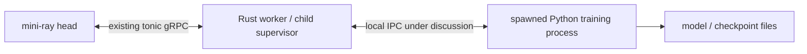

# Python worker IPC: Ray's design and mini-ray options

Status: Design comparison and proposed decisions; no IPC launcher implementation.
Reviewed: 2026-10-31.
Related: [Python launcher design](launcher-design.md).

## Decision

For the first one-shot CPU training demonstration, retain the existing proposed JSON-file contract and OS exit status. It needs configuration and a final result, with stdout/stderr redirected to files.

For the first interactive Python launcher on Linux/macOS, prefer a **Unix domain stream socket with length-prefixed JSON** between the Python child and its owning Rust worker. This provides a dedicated bidirectional channel for readiness, progress, results, and cooperative cancellation without mixing protocol messages with training logs. This is a proposed next milestone, not an additional requirement for the first demo.

If generated service APIs and cross-platform or remote endpoints become requirements, prefer **gRPC/Protobuf over loopback TCP** instead. Consider shared memory only after measuring a bottleneck in large local data transfers; keep a separate control channel.

These are workload-based design judgments, not benchmark results. No transport is selected because it is universally fastest.

## Which boundary are we designing?

In Ray, a Python worker embeds a native C++ core worker. That runtime talks to the local raylet. Ordinary training code does not implement Ray's private registration protocol in Python.

In mini-ray, the closest current boundary is different:



The Rust worker owns the child and reports task outcomes to the head. There is no standalone raylet process in mini-ray. This proposal does not make Python a registered scheduler worker or change the head protocol.

## What Ray actually uses

The source observations below are grounded in the local Ray checkout at commit [`b768e90690ac934b69ef7d0ac3a6f8f1d1c19a6c`](https://github.com/ray-project/ray/commit/b768e90690ac934b69ef7d0ac3a6f8f1d1c19a6c), dated 2025-11-14. They describe that inspected snapshot, not a guarantee for every Ray version. Current official documentation was also consulted on the review date.

| Path | Transport / protocol | Purpose |
| --- | --- | --- |
| Python API to embedded core worker | In-process native binding | Bridge Python execution into Ray's C++ runtime. |
| Core worker to local raylet IPC endpoint | Local stream socket plus framed FlatBuffers messages | Registration, port announcement, disconnect, and selected local object/lifecycle operations. |
| Core worker to raylet RPC endpoint | gRPC/Protobuf over an IP/port channel | Worker leases and other scheduling/resource RPCs. |
| Submitting core worker to executing core worker | gRPC/Protobuf, including `PushTask` | Deliver task/actor calls to their executor. |
| Local object data | Separate object-store/shared-memory mechanisms | Large data is not assumed to travel in registration messages. |
| PyTorch distributed workers | PyTorch communication backend, commonly NCCL or Gloo | Tensor collectives such as DDP gradient synchronization. |

The official [port-discovery guide](https://docs.ray.io/en/latest/ray-core/internals/port-service-discovery.html) identifies Unix domain sockets on Linux/macOS and localhost TCP on Windows for the local IPC path. Registration and announcement discover a separate worker RPC port.

The inspected `RayletIpcClient::RegisterClient` sends a FlatBuffers registration request and reads a reply; `AnnounceWorkerPortForWorker` writes the worker's listening port. Its connection layer prefixes messages with a cookie, message type, and payload length. Separately, `rpc::RayletClient` builds a gRPC `NodeManagerService` client from an address and port and exposes `RequestWorkerLease`. See source references [R1]-[R4].

The useful lesson is to separate local lifecycle control, RPC, and bulk data. Reimplementing Ray's internal wire format is unnecessary for mini-ray and does not provide a supported way for an arbitrary Python script to join Ray. For actual Ray integration, use Ray's public APIs and runtime.

## Compare layers separately

| Layer | Examples | Question it answers |
| --- | --- | --- |
| Transport | Files, pipes, socket pair, Unix socket, TCP, shared memory | How do bytes reach another process? |
| Framing / encoding | Length prefix + JSON, newline-delimited JSON, Protobuf, FlatBuffers | Where does a message end and how is it decoded? |
| Conversation | Hello, Ready, Run, Result, Cancel; request IDs and acknowledgements | What do the messages mean and when are they valid? |
| RPC framework | gRPC | Who supplies generated methods, status codes, streaming, and deadlines? |
| Supervision | Child handle, exit status, deadlines, termination and reaping | Who owns execution when communication fails? |

JSON does not select a transport. Protobuf does not require gRPC. A Unix socket can carry a custom protocol or an RPC framework if the chosen language libraries support that deployment. A successful send is not proof that training started or a result was committed.

## Transport comparison

The effort estimates are relative to this Rust/Python project and its current dependency set. Performance descriptions are qualitative; implementations and workloads must be measured.

| Option | Strengths | Costs and failure modes | Fit here |
| --- | --- | --- | --- |
| JSON files + exit status | Simple integration with existing scripts; inspectable artifacts; logs stay separate | Final result needs process completion; live control needs extra machinery; partial/stale files and retention need rules | First one-shot demo; already proposed |
| stdin/stdout pipes | Broad OS support; directly attached to the child; no listener discovery | stdout printing can corrupt protocol; bounded pipe buffers can deadlock; require framing and concurrent reading/writing | Small controlled scripts with a dedicated stdout protocol |
| Dedicated inherited pipes | Protocol stays separate from stdout/stderr | Usually need two pipes for bidirectional control; descriptor/handle mapping across Rust exec and Python startup adds work | Viable when descriptor inheritance is already supported |
| Connected socket pair | Full duplex, no pathname/port discovery, naturally belongs to one parent/child pair | Must deliberately preserve the child's endpoint across exec and close unused copies; descriptor handling is OS-specific | Strong local alternative for a parent-child-only API |
| Unix domain stream socket | Dedicated full-duplex channel; normal Rust/Python socket APIs; child connects by path; can later serve several children | Path permissions/length, stale socket cleanup, framing and timeout handling; not the baseline Windows implementation | Preferred first interactive Linux/macOS channel |
| Raw loopback TCP | Familiar APIs, good tooling, portable transport, possible future remote endpoints | Port discovery and authentication needed; still requires a custom protocol; loopback alone is not client authentication | Cross-platform alternative when gRPC is unwanted |
| gRPC/Protobuf over loopback TCP | Generated Rust/Python contracts; structured statuses; streaming and deadlines; existing tonic/Protobuf experience | Add Python gRPC dependencies/codegen and service lifecycle; cancellation still needs application handling | Preferred when a typed worker service or cross-platform API justifies it |
| Shared memory / memory mapping | Can avoid copying large local payloads over a socket | Needs layout, synchronization, ownership, bounds, cleanup, and separate notification; CPU shared memory is not GPU IPC | Later bulk-data optimization after measurement |
| POSIX FIFO / Windows named pipe | Named local endpoints; Windows pipes offer native duplex/server features | Different APIs and semantics; opening/EOF/permissions need care; POSIX FIFOs are not portable duplex Windows pipes | Platform-specific adapter if Windows requirements warrant it |

Python's [subprocess documentation](https://docs.python.org/3/library/subprocess.html#subprocess.Popen.communicate) explains pipe deadlocks and memory implications of collected output. Streaming protocols must drain traffic continuously rather than wait for child exit before reading. Direct log-file redirection avoids filling parent-owned log pipes.

Python [`socketpair`](https://docs.python.org/3/library/socket.html#socket.socketpair) and Rust [`UnixStream::pair`](https://doc.rust-lang.org/std/os/unix/net/struct.UnixStream.html#method.pair) support connected endpoints, but descriptor inheritance remains a launcher responsibility. Do not clear close-on-exec indiscriminately or assume Python's `pass_fds` option applies to a Rust parent. A named Unix socket avoids that initial integration work.

Unix socket streams have no application message boundaries. Handle partial reads/writes. Use short paths in a private local runtime directory and validate platform path limits; avoid Linux-only abstract sockets in the initial macOS/Linux implementation. See [Unix sockets](https://man7.org/linux/man-pages/man7/unix.7.html) and [Python socket behavior](https://docs.python.org/3/howto/sockets.html).

Windows [named pipes](https://learn.microsoft.com/en-us/windows/win32/ipc/named-pipes) have their own security and remote-access behavior. Loopback TCP is the simpler proposed Windows fallback. This is a portability choice, not a claim that every Windows version lacks Unix sockets.

Signals remain useful for lifecycle escalation but are not a structured result channel. Python `multiprocessing.Queue`/`Pipe` and broker libraries are not drop-in Rust/Python protocols: using them still requires compatible serialization and lifecycle rules. A broker or ZeroMQ would add another abstraction without a requirement in the first launcher.

## Encoding and RPC choice

| Choice | Benefits | Tradeoff / decision |
| --- | --- | --- |
| Length-prefixed JSON | Easy to inspect; Python standard library; explicit stream boundaries | Validate schema/types/limits manually; recommended for initial local control |
| Newline-delimited JSON | Easy manual inspection and command-line tooling | Enforce a bounded line length; still needs partial-read handling; keep stdout logs separate |
| Protobuf messages | Shared schema and generated types; useful evolution rules | Codegen and Python packaging; good successor if schema maintenance becomes burdensome |
| FlatBuffers messages | Shared schema and direct-access binary layout | More tooling and lifetime/layout concerns; Ray's use alone is insufficient reason to adopt it |
| gRPC + Protobuf | Typed RPCs with framework-supplied streaming/status/deadline behavior | More dependencies; a candidate replacement for the custom conversation if requirements grow |

Keep JSON at the Rust/Python boundary. Rust's existing bincode task encoding remains internal to mini-ray; Python is not expected to decode it. Avoid pickle as the cross-language wire contract.

gRPC is listed alongside transports for practical comparison, but it is an RPC stack. Using gRPC over a Unix socket is possible in compatible libraries; validate the project's exact tonic/Python versions and connection adapters before selecting that combination. No such compatibility test was run for this document. Framework flow control does not remove the need for bounded application queues, and RPC cancellation does not itself kill a Python process. See [gRPC concepts](https://grpc.io/docs/what-is-grpc/core-concepts/), [flow control](https://grpc.io/docs/guides/flow-control/), and [deadlines](https://grpc.io/docs/guides/deadlines/).

## Proposed interactive Unix-socket design

This section is a concrete next-step design, not implemented behavior. It retains one Python process per invocation; process reuse and multi-child multiplexing require separate decisions.

### Ownership and bootstrap

1. The Rust worker creates an invocation ID and a private local runtime directory, binds a short socket path, and starts listening before spawning Python. On Unix, set the directory to owner-only access and restrict the socket endpoint. Store logs/artifacts separately if their paths are too long for the socket.
2. Spawn the configured interpreter using an argument vector. Pass the endpoint path and invocation ID as configuration. Keep a per-launch random secret out of argv/logs; deliver it through controlled child configuration, such as its environment. This is local admission control, not isolation from malicious same-user code.
3. Python's bootstrap connects and sends `Hello` with its wire version, invocation ID, and secret. Rust validates the launch context and replies `HelloAck`. PID metadata can aid diagnostics but is not authentication.
4. Python completes imports/bootstrap and sends `Ready`. Merely connecting or creating a PID is not readiness.
5. Rust sends one `Run`; Python emits `Started` immediately before invoking the training function. Progress and terminal messages carry the invocation ID.
6. The child sends one terminal `Result`, `Error`, or `Cancelled` and exits. Rust checks the terminal message, exit status, and expected artifact before reporting the outcome to the head. A valid result with a nonzero exit is a failure in this one-shot design.

Use a small Python bootstrap module to keep socket/protocol concerns separate from the training function. Stdout and stderr remain ordinary training logs. A long-lived bootstrap should own the IPC reader independently of the training loop if it must receive cancellation while training is active.

```mermaid
sequenceDiagram
    participant W as Rust worker
    participant P as Python bootstrap
    W->>W: Bind socket; spawn child
    P->>W: Hello(version, invocation, secret)
    W->>P: HelloAck
    P->>W: Ready
    W->>P: Run(config)
    P->>W: Started
    loop Optional progress
        P->>W: Metric
    end
    P->>W: Result or Error or Cancelled
    P->>P: Exit
    W->>W: Validate terminal message, exit and artifacts
    Note over W: Publish through existing head RPCs
```

### Framing and validation

Proposed frame: four-byte unsigned big-endian JSON byte length, followed by exactly that many UTF-8 bytes. Initial maximum: 64 KiB per frame, including configuration and terminal metadata. This is a chosen budget, not a measured optimum.

```text
+-------------------------+------------------------------+
| u32 big-endian N        | N bytes of UTF-8 JSON        |
+-------------------------+------------------------------+
```

Representative message after handshake:

```json
{
  "wire_version": 1,
  "kind": "metric",
  "invocation_id": "<generated UUID>",
  "sequence": 3,
  "payload": { "step": 20, "loss": 0.12 }
}
```

`wire_version` is distinct from the existing training configuration's `protocol_version`. Each direction has its own increasing sequence, starting at 1. Protocol state determines the allowed next message kind; reserved handshake fields have their own schema. Reject wrong versions/IDs, unknown message kinds, duplicate or regressing sequences, invalid UTF-8/JSON, nonfinite metric numbers, and frames exceeding the limit before allocating their claimed payload size. Optional payload fields may evolve only under documented schema rules.

Sequence numbers aid validation and diagnosis. They do not implement reconnection, durable replay, or exactly-once execution. Version 1 allows no reconnect/resume after channel failure. Large model weights and datasets stay out of control frames.

For this interactive version, the terminal socket message becomes the result contract; an optional JSON file is a diagnostic copy. The first demo continues to use `result.json` as described in the launcher design. Do not silently require both contracts or accept whichever disagrees more favorably.

### Backpressure, cancellation, and deadlines

- Run one serialized writer per connection direction and keep readers active. Bounded outbound queues prevent memory growth. Coalesce/drop optional progress messages before assigning wire sequences; never silently drop readiness or terminal messages. Control messages take priority over unsent metrics, but cannot preempt bytes already written to a stream.
- Configure startup, frame-read/write, execution, and shutdown deadlines. A partial frame cannot keep a reader blocked forever. Progress silence alone is not proof that a training job is dead. A control heartbeat also does not prove training is advancing.
- Rust can send `Cancel`. Receipt/acknowledgement is not proof of cancellation: Python may be executing a long native operation. After a bounded grace period, the supervisor terminates and reaps the child if necessary. A cooperative `Cancelled` outcome requires actual termination of training and process exit under this one-shot contract.
- EOF/reset before a terminal result is an execution failure. EOF after a result is expected only with a successful process exit and valid artifact. Nonzero exit, malformed protocol, or a hung child fails the invocation. Do not retransmit `Run` on a new socket automatically.
- On normal cleanup, close accepted sockets and listener, reap the child, and remove only the endpoint owned by this invocation. Retain logs/artifacts for diagnosis. Use bounded waits; OS cleanup may exceed nominal deadlines.
- On forced parent death, a pipe or socket closing does not automatically stop Python computation. Python can monitor EOF; reliable descendant cleanup additionally needs a separately designed process-group/parent-lifetime strategy. Do not promise it from transport choice alone.

### Task ownership and supervision are separate guarantees

`Started` acknowledges that the child began a local invocation. It is not the head's task-start acknowledgement or a scheduler lease. The current raw handler receives arguments without task/attempt context. Mapping invocation IDs to task IDs and propagating cancellation from the head will require worker/runtime integration.

The head's acknowledged-start and stale-report fencing work remains necessary before claiming reliable multi-worker execution. Switching from files to sockets or gRPC does not repair stale ownership, repeated external effects, retry semantics, or checkpoint resume. The existing launcher design records these limits.

The socket also cannot publish a model file to another machine. Return artifact metadata through mini-ray and use shared storage or a future fetch/upload API for remote artifact access.

### Memory pressure and OOM

The supplied [Ray OOM-prevention guide](https://docs.ray.io/en/latest/ray-core/scheduling/ray-oom-prevention.html) adds an important supervision requirement. Ray's Linux raylet memory monitor considers worker heap, object store, and raylet usage and can kill workers under pressure. The documented default checks every 250 ms with a 0.95 usage threshold; resource-isolation mode has additional settings and conditional guarantees. Monitor-triggered task retries have special behavior, while actor restart policy differs. These are Ray policies, not behavior inherited by mini-ray.

Current mini-ray samples pressure and stops assigning new leases at high/critical pressure. It does not implement that active worker-killing policy. A growing Python child can therefore still exhaust memory after admission stops. Changing IPC transport will not supply memory containment.

Proposed supervisor rules:

| Observation | Report / action |
| --- | --- |
| EOF/reset without terminal message | Channel/child failure; inspect child status and supervisor records before assigning a cause |
| Unix SIGKILL termination | Record the signal; do not label it confirmed OOM without corroboration |
| Supervisor deliberately kills a child for memory pressure | Record that decision before signalling, then reap and report the recorded reason |
| Structured Python allocation/CUDA-memory error | Preserve the application error; do not assume it was a node OOM kill |

Keep frame/queue/log buffers bounded and model data outside control messages. Any future memory controller should account for the Python process and supported descendants, stop admission under pressure, reserve supervisor headroom, and explicitly define eviction and retry policy. Keep mini-ray retries bounded by its own configured policy; avoid a local retry loop that compounds memory pressure. Cgroup containment, victim selection, and descendant cleanup need separate implementation and evidence. For a deterministic first failure experiment, terminate a fixture process and check classification; run real OOM experiments only in a resource-limited disposable environment, not by exhausting the development machine.

## Why this decision fits the first milestone

| Requirement / trigger | Choice |
| --- | --- |
| One script, configuration, final metrics/model path; no live control | Keep JSON files + process exit |
| Live readiness/progress/cancellation on current macOS/Linux scope | Add Unix stream socket + framed JSON |
| Parent-child-only topology with an established FD-passing layer | Reconsider socket pair |
| Windows support or a typed reusable worker service | Reconsider loopback gRPC/Protobuf |
| Measured serialization/copy cost for large local arrays | Add shared memory under the existing control protocol |
| GPU gradient synchronization across training workers | PyTorch distributed backend; separate training design |

Unix sockets win the proposed interactive milestone because they provide a dedicated local channel with straightforward connection setup in both languages. Socket pairs avoid endpoint management but move complexity into cross-language exec inheritance. Pipes are simpler to spawn but need explicit separation from arbitrary training output. gRPC provides more API machinery than the one-child conversation currently needs.

## Verification plan before implementation is called complete

Use the same protocol fixtures for any candidate control transport:

| Check | Evidence required |
| --- | --- |
| Framing | Split headers/bodies over many writes, concatenate frames, send oversized lengths and truncated messages; parser handles or rejects each within bounds |
| Bootstrap | Delayed readiness, import failure, wrong version/secret/invocation, and unexpected second connection cannot start training |
| Logging / backpressure | Large stdout/stderr and fast metric emission do not deadlock; queues remain bounded and terminal state is preserved |
| Outcome | Result + exit zero succeeds only after artifact validation; nonzero exit, missing terminal, duplicate terminal, and malformed data fail |
| Cancellation | Cooperative stop and a native-style unresponsive fixture both reach the specified cleanup outcome; acknowledgment alone is insufficient |
| Failure | Child dies before Ready, during execution, or after Result; parent death and surviving descendants are recorded separately |
| Memory-related failure | Supervisor-initiated pressure kill, generic forced termination, and structured allocation error retain distinct reasons; EOF/SIGKILL alone is not misreported as confirmed OOM |
| Isolation of invocations | Retry gets fresh endpoint/output directory; old connection cannot publish into a new invocation |
| Actual integration | Separate head/worker/consumer/Python processes; real CPU PyTorch improves loss, reloads weights, and preserves worker heartbeats |

Fixtures prove launcher behavior; a real PyTorch experiment proves the exercised integration only. Neither is evidence for untested multi-worker recovery.

If performance influences a later choice, compare the same message schema and workload over pipes, socket pair, Unix socket, and loopback TCP/gRPC. Measure handshake/readiness time separately from control round-trip latency, throughput, CPU use, peak queue memory, and cleanup time. Exercise small control messages, the configured maximum frame, metric bursts, and several concurrent children. Exclude model training and Python import time from transport-only measurements, then run the end-to-end workload separately. Publish environment and distributions, not unsupported speed rankings.

## Sources and evidence scope

Ray source links below pin the inspected checkout. Documentation links are living references and can describe later releases; implementation details above are scoped to the stated source revision.

- [R1: Ray IPC client](https://github.com/ray-project/ray/blob/b768e90690ac934b69ef7d0ac3a6f8f1d1c19a6c/src/ray/raylet_ipc_client/raylet_ipc_client.cc): registration and port announcement.
- [R2: Connection framing](https://github.com/ray-project/ray/blob/b768e90690ac934b69ef7d0ac3a6f8f1d1c19a6c/src/ray/raylet_ipc_client/client_connection.cc) and [FlatBuffers schema](https://github.com/ray-project/ray/blob/b768e90690ac934b69ef7d0ac3a6f8f1d1c19a6c/src/ray/flatbuffers/node_manager.fbs).
- [R3: Raylet gRPC client](https://github.com/ray-project/ray/blob/b768e90690ac934b69ef7d0ac3a6f8f1d1c19a6c/src/ray/raylet_rpc_client/raylet_client.cc): IP/port channel and worker-lease RPC.
- [R4: Core worker](https://github.com/ray-project/ray/blob/b768e90690ac934b69ef7d0ac3a6f8f1d1c19a6c/src/ray/core_worker/core_worker.cc) and [task RPC schema](https://github.com/ray-project/ray/blob/b768e90690ac934b69ef7d0ac3a6f8f1d1c19a6c/src/ray/protobuf/core_worker.proto).
- [Ray port service discovery](https://docs.ray.io/en/latest/ray-core/internals/port-service-discovery.html): platform-specific local socket path and separate RPC-port announcement.
- [Ray OOM prevention](https://docs.ray.io/en/latest/ray-core/scheduling/ray-oom-prevention.html): Linux memory monitoring, pressure-based termination, and policy-specific retry behavior; current documentation is newer than the pinned source snapshot.
- [Ray Core concepts](https://docs.ray.io/en/latest/ray-core/key-concepts.html) and [Ray PyTorch integration](https://docs.ray.io/en/latest/train/getting-started-pytorch.html): objects and training integration.
- [Python subprocess](https://docs.python.org/3/library/subprocess.html#subprocess.Popen.communicate), [sockets](https://docs.python.org/3/library/socket.html), and [shared memory](https://docs.python.org/3/library/multiprocessing.shared_memory.html): transport mechanics. Shared-memory cleanup ownership must be explicit for independently spawned processes, including Python resource-tracker behavior.
- [Unix socket manual](https://man7.org/linux/man-pages/man7/unix.7.html), [Rust UnixStream](https://doc.rust-lang.org/std/os/unix/net/struct.UnixStream.html), [Windows named pipes](https://learn.microsoft.com/en-us/windows/win32/ipc/named-pipes), and the gRPC guides linked above.

No IPC benchmark, Rust/Python prototype, or real PyTorch test was run for this comparison. All mini-ray transport changes remain proposed.
